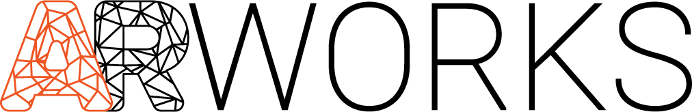

# ARworks brand kit

This folder **is** the skill and the brand kit. Everything is relative to this file's directory (the repo root: `dist/`, `logos/`, `icons/`, `examples/`, `BRAND.md`). Full rules: `BRAND.md`. Working reference markup: `examples/landing.html` (light + dark), `examples/brand-sheet.html`, `examples/og-card.html`.

## The look in 8 lines

1. **One accent color: orange `#EF5422`.** Everything else is white / near-black / pure grey. No second accent, no gradients on buttons.
2. **Type:** Jost 300 UPPERCASE with 0.08em tracking for headlines (64/44/30 px); Space Grotesk for body/UI (16 px / 1.55); Space Mono UPPERCASE 12 px with 0.14em tracking for kickers/labels (kicker colour = orange).
3. **Flat, hairline, technical:** 1 px `#E0E0E0` borders, radius 0 / 2 px (buttons, inputs) / 4 px (cards), almost no shadow. Hover changes colour or border, never lifts or scales.
4. **Light page, black footer.** Dark bands allowed inside light pages; dark theme = `#0A0B0C` page, `#101214` cards.
5. **Hero pattern:** mono kicker → large display headline → short lede → one orange primary + one outline button.
6. **Little text, big headlines, real images** (project photos, screen captures, 3D renders). Details go into pop-ups/accordions. Headlines are short, benefit-led sentences.
7. **Logo files only** — never redraw, recolour, stretch or AI-generate the logo or its text. Header logo is 20 px tall.
8. **Calm motion:** 120–350 ms, `cubic-bezier(0.16,1,0.3,1)`, meaningful (process, function), honour `prefers-reduced-motion`.

## Use it — pick the stack

**Plain HTML / any framework** — copy `dist/arworks.css` (or `dist/arworks-nofonts.css` if you self-host fonts) and the `logos/` + `icons/` files you need into the project, then:

```html
<link rel="stylesheet" href="arworks.css">
<header class="arw-header"><div class="arw-header__bar">
  <a class="arw-header__logo" href="/"></a>
</div></header>
<section class="arw-sec arw-sec--hero"><div class="arw-wrap">
  <div class="arw-kicker">ARworks — Budapest · 2011 óta</div>
  <h1 class="arw-display arw-display--xl">Mutassa meg az autót</h1>
  <p class="arw-lede arw-lede--lg">…</p>
  <a class="arw-btn arw-btn--primary arw-btn--lg">Projektet indítok</a>
  <a class="arw-btn arw-btn--outline arw-btn--lg">Munkáink</a>
</div></section>
```

No local copy wanted? Link a pinned release: `https://cdn.jsdelivr.net/gh/Sabolo100/arworks-brand@v1.0.0/dist/arworks.css` (logos at the same base path).

Dark theme: `<html data-theme="dark">` (or `class="arw-dark"` on a container). Logos swap by themselves via `.arw-logo--onlight/--ondark`.

**Tailwind v3:** `presets: [require('./arworks-brand/dist/tailwind.preset.cjs')]`, plus load `dist/arworks-tokens.css`. **Tailwind v4:** `@import './arworks-brand/dist/arworks-tokens.css'; @import './arworks-brand/dist/tailwind-v4.css';`. Utilities: `bg-brand text-ink bg-surface border-line font-display tracking-display rounded-sm`.

**Not web (slides, Figma, Office, native):** `dist/tokens.json` has every value (colors, type scale, spacing, radius, shadows, motion). Fonts: Jost, Space Grotesk, Space Mono (Google Fonts, free). Logos: `logos/*.png`.

**Social / OG image:** `examples/og-card.html` → screenshot at exactly 1200×630 (`social/` has the two production images).

## Component classes (all `arw-` prefixed)

`arw-btn` + `--primary|secondary|outline|ghost|inverse` + `--sm|md|lg` · `arw-card` + `--padded|accent|featured|inverse|interactive` (`__kicker`, `__title`, `__photo`) · `arw-tag` + `--interactive|selected` · `arw-field` `arw-input` `arw-check` · `arw-status--success|warning|danger` · `arw-kicker` `arw-mono-label` `arw-display--xl|lg|md` `arw-lede` `arw-rule` · `arw-wrap` `arw-sec` (`--hero|line|dark|subtle`) `arw-grid--2|3|4` `arw-hero-grid` · `arw-header` `arw-nav` `arw-lang` `arw-footer`.

Need something not listed? Build it from tokens (`var(--orange-500)`, `var(--border-default)`, `var(--space-5)`, `var(--radius-md)` …) and keep to the rules above — don't add new colours.

## Before you finish

- [ ] Only `#EF5422` (and `--orange-600` for orange text on white) used as accent; no other brand colours.
- [ ] Headlines uppercase Jost 300; kickers/labels Space Mono uppercase; body Space Grotesk.
- [ ] Logo from `logos/`, right variant for the background, correct height, `alt="ARworks"`.
- [ ] Corners 0/2/4 px, hairline borders, no hover lift, no gradient buttons.
- [ ] Focus ring visible, contrast ≥ 4.5:1 (see `BRAND.md` §7 for the two known weak spots), reduced-motion respected.
- [ ] Hungarian copy: correct accents (ő, ű), short imperative button labels; the name is written "ARworks".
- [ ] Phone ≤ 390 px wide: no horizontal scroll.

Brand assets (`logos/`, `icons/`, `social/`, the ARworks name) are © ARworks — use only for ARworks and ARworks-authorized work (see `LICENSE`).
